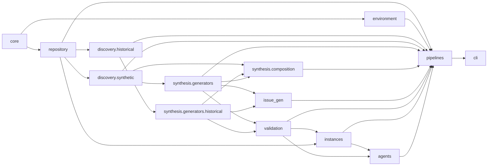

# RF Factory architecture

RF Factory discovers refactoring opportunities from historical revisions or synthetic analysis, builds private task contracts and Gold patches, validates generated instances, and publishes solver-facing tasks. Compound and Hybrid describe composition, not additional discovery sources. The public CLI and the existing `rf.instance.v3` and ProMax output formats remain unchanged.

## Package layout

```text
rf_factory/
  core/                       models, config, serialization, process results
  repository/                 snapshots, Git history, GitHub source records
  environment/                pinned Docker builds, local Docker, image export
  discovery/
    historical/               AST evidence, classification, batch scan
    synthetic/                API and responsibility discovery, usage graph, ranking
  synthesis/
    generators/               TaskSpec and Gold generation
    composition/              synthetic and historical relationship/replay logic
  issue_gen/                  solver-facing problem text
  validation/                 portable verifier, acceptance tests, instance gates,
                              solution evaluation
  instances/                  local Instance construction and publication
  agents/                     solver workspace export and Agent Runner
  pipelines/                  CLI and local, real, historical, compound, hybrid orchestration
  fixtures/                   unchanged packaged sample repositories
  prompts/                    unchanged problem-statement policy
  __init__.py                 Python package marker
  __main__.py                 python -m rf_factory entry
```

The former top-level compatibility modules have been removed. Import implementations from their functional packages. `rf_factory.repository` is now a package whose `__init__.py` exports `manifest`, `RepositoryPreparer`, and `IGNORED`. The console command and `python -m rf_factory` remain available; `rf_factory.cli` and the other deleted module paths do not.

## Runtime dependencies



The graph shows actual allowed calls rather than a required linear chain. `core/process.py` owns the common checked subprocess contract; historical modules no longer import process helpers from `real_pipeline.py`. `pipelines/real.py` invokes `pipelines/compound.py` for the optional compound route, while composition functions and acceptance generation reside below the pipeline layer. The former `compound` ↔ `real_pipeline` import cycle is removed.

## Execution routes

| Public command | Discovery and synthesis | Validation and output |
| --- | --- | --- |
| `demo`, `run` | Configured API or responsibility discovery → TaskSpec and Gold | Host baseline, portable structural/regression/functional verifier, Gold/No-op gate → `rf.instance.v3` |
| `run-real` | Automatic API recipe discovery → single migration | Fixed-commit Docker baseline, independent Test Patch, Gold/No-op → ProMax row |
| `run-real --compound` | Related synthetic pair → ordered, isolated migration replay → Base-to-final Gold | Baseline, Gold, No-op, clean apply, both Partial and own-subtask checks |
| `history-scan` | GitHub PR metadata, Git lineage, AST structural evidence | Discovery report only; no Docker-verified instance |
| `run-history` | PR, Issue, or Commit source → historical candidate, TaskSpec, developer Gold | Historical acceptance strategy, Docker baseline/Gold/No-op/clean apply → ProMax row |
| `run-history-compound` | Two consecutive revisions → relationship and unified Gold | Independent acceptance, Docker controls, applicable Partial variants → ProMax row |
| `run-hybrid-compound` | Historical relocation pair → two dependent synthetic API migrations | Four-subtask Docker controls and Base-to-final Gold → ProMax row |
| `prepare-rollout`, `run-agent` | Export clean base and task; run external solver | Collect Model Patch; fresh offline Docker solution evaluation; record attempts and usage |

Historical and Synthetic are provenance labels in the shared `RefactoringCandidate` and `RefactoringTaskSpec` model. The local synthetic `TaskSpec` remains in use and is projected through `synthesis/candidate_pool.py` where a source-neutral representation is needed. `CompoundTaskSpec` preserves ordered subtasks and dependency edges. Hybrid uses historical and synthetic subtasks in one composition rather than defining a third discovery source.

## Migration map

All former top-level Python modules are accounted for here. Several mixed-duty modules map to more than one implementation file. The old module paths are removed except the package bootstrap files; `repository` remains importable at the same spelling because it is now a package.

| Former module | Canonical implementation |
| --- | --- |
| `__init__.py` | unchanged |
| `__main__.py` | unchanged |
| `agent_runner.py` | `agents/runner.py`; Docker solution evaluation in `validation/solution.py` |
| `api_migration.py` | `discovery/synthetic/api_migration.py`, `synthesis/generators/api_migration.py` |
| `base_image.py` | `environment/base_image.py` |
| `candidate_pool.py` | `synthesis/candidate_pool.py` |
| `candidates.py` | `discovery/synthetic/ranking.py` |
| `cli.py` | `pipelines/cli.py`; run-and-publish dispatch in `pipelines/dispatch.py` |
| `common.py` | `core/common.py` |
| `compound.py` | `synthesis/composition/synthetic.py`, `pipelines/compound_preflight.py`, `pipelines/compound.py` |
| `config.py` | `core/config.py` |
| `difficulty.py` | `synthesis/difficulty.py` |
| `evaluator.py` | `validation/evaluator.py` |
| `history.py` | `repository/github.py`, `repository/git_history.py`, `synthesis/generators/historical.py`, `pipelines/historical.py` |
| `history_acceptance.py` | `validation/historical_acceptance.py` |
| `history_analysis.py` | `discovery/historical/analysis.py` |
| `history_composition.py` | `synthesis/composition/historical.py` |
| `history_compound.py` | `repository/git_history.py`, `synthesis/composition/historical.py`, `pipelines/historical_compound.py` |
| `history_scan.py` | `discovery/historical/inputs.py`, `repository/cache.py`, `pipelines/history_scan.py` |
| `hybrid_compound.py` | `synthesis/generators/dependent_migrations.py`, `synthesis/composition/hybrid.py`, `validation/hybrid_controls.py`, `pipelines/hybrid.py` |
| `instance_builder.py` | `instances/builder.py` |
| `models.py` | `core/models.py` |
| `oracle.py` | `validation/oracle.py` |
| `pipeline.py` | `pipelines/local.py`; Docker work moved to `environment/local_docker.py` |
| `problem_generation.py` | `issue_gen/generator.py` |
| `publish.py` | `instances/publish.py` |
| `real_pipeline.py` | `core/process.py`, `discovery/synthetic/recipes.py`, `validation/synthetic_acceptance.py`, `environment/pinned.py`, `pipelines/real.py` |
| `repository.py` | `repository/snapshot.py`, re-exported by `repository/__init__.py` |
| `responsibility_migration.py` | `discovery/synthetic/responsibility.py`, `synthesis/generators/responsibility.py` |
| `rollout.py` | `agents/rollout.py` |
| `test_runner.py` | `validation/test_runner.py` |
| `usage_analysis.py` | `discovery/synthetic/usage_analysis.py` |
| `verifier.py` | `validation/verifier.py` |

The 36 fixture Python files, nine original test files, existing scripts, Dockerfiles, examples, and seven pre-existing documents stay in place. `pyproject.toml` still discovers `rf_factory*`; fixture and prompt package-data paths remain valid.

## Portable validation and import paths

The local pipeline copies canonical `validation/verifier.py`, `validation/test_runner.py`, and `discovery/synthetic/usage_analysis.py` into one `verifier/<candidate-id>/` directory as `runner.py`, `test_runner.py`, and `usage_analysis.py`. When imported inside the package, the verifier uses the functional module; when executed as a copied script, it imports its sibling. `BaselineOracle` locates the canonical test runner beside itself.

Tests and other Python callers now use canonical imports such as `rf_factory.agents.runner` and `rf_factory.pipelines.history_scan`. Monkeypatch `prepare_rollout` and `_evaluate` on `rf_factory.agents.runner`, and `github_json` on `rf_factory.pipelines.history_scan`. The deleted top-level paths are intentionally no longer supported.

`validation/instance.py` holds distinct pre-publication gates for Real, Historical, Synthetic Compound, Historical Compound, and Hybrid. `validation/solution.py` applies a Model Patch and executes `eval.json` in a fresh offline container. A solver solution is accepted by the instance checks, not by comparing its bytes with Gold.

## Extending the factory

Add a new candidate analyzer under `discovery/historical/` or `discovery/synthetic/` according to its evidence source. Add the corresponding TaskSpec and Gold transformation under `synthesis/generators/`; use `synthesis/composition/` only when combining subtasks. Put solver-facing wording in `issue_gen/`, acceptance and control rules in `validation/`, Docker resources in `environment/`, and route orchestration in `pipelines/`. Preserve the existing `core/models.py` contracts and published schemas unless a separate schema migration is approved.

## Output and research boundaries

Generated data stays in the requested collection and `.rf-factory-work/`, not in the Python package. Published local instances retain shared `_bases`; real instances retain pinned image references, `/testbed`, `instances.jsonl`, `swe-bench-promax.json`, `eval.json`, `gold.patch`, and `test.patch` where the route previously emitted them. `prepare-rollout` exports only `repository/`, `task.md`, and `environment.json`; Gold, hidden acceptance tests, Oracle, Partial controls, and provenance remain controller-side.

Some route-specific output assembly and subprocess sequences remain explicit in `pipelines/` to preserve artifact ordering and error behavior. The Hybrid goal still contains the existing HTTPX-specific wording, and static call analysis still excludes dynamic patterns. These are separate behavior changes and were not altered by this package-layout migration.
