# Historical Compound: two real HTTPX refactorings

The controller accepts two explicitly selected GitHub PR URLs or full commits. Each revision must classify as an eligible historical refactoring. The current safe replay rule requires the second revision's Base to equal the first revision's target, so intervening unrelated commits never enter the Gold Patch. The pair must also have structural evidence of a shared responsibility or affected symbols. Two unrelated edits in the same repository are rejected.

```mermaid
flowchart LR
  A[PR URLs or full commits] --> B[Resolve Git provenance]
  B --> C[Discover both Historical tasks]
  C --> D[Check adjacency and relationship]
  D --> E[Replay both revisions in isolated clone]
  E --> F[One Base to final Git diff]
  F --> G[Independent subtask acceptance tests]
  G --> H[Docker Baseline, No-op, Gold, Partial, clean apply]
  H --> I[One ProMax Instance]
```



`history_compound.py` orchestrates this path. It reuses `history.py` for provenance and discovery, `history_analysis.py` for AST operations, `history_acceptance.py` for independent structural checks, `CompoundTaskSpec` for the private contract, `problem_generation.py` for one solver task, `real_pipeline.eval_script` for regression plus acceptance, and the existing publisher and rollout isolation. The original developer patches are retained as provenance, never concatenated to form Gold.

## Verified source and relationship

- Repository: `https://github.com/encode/httpx`
- Common Base: `66225539796d819b5114ead2fd5e4d61865ab708`
- Subtask A: [`83a85189c79708b732d04e7b906e388fb0fbde94`](https://github.com/encode/httpx/commit/83a85189c79708b732d04e7b906e388fb0fbde94), associated with PR #3382. Relocate `normalize_header_key` and `normalize_header_value` from `httpx/_utils.py` to the header owner `httpx/_models.py`, updating `Headers` callers.
- Subtask B: [`6212e8fa3bf90154b891c7721f6d29737caac861`](https://github.com/encode/httpx/commit/6212e8fa3bf90154b891c7721f6d29737caac861), associated with PR #3388. Relocate `format_form_param` and `guess_content_type` from `httpx/_utils.py` to `httpx/_multipart.py`, updating multipart field callers.

The second commit's first parent is exactly the first commit. Both remove used helpers from the same utility module and move them to the owning domain modules. This is a shared responsibility split, with distinct acceptance checks for header and multipart migration. Click PR #3371 was investigated as a possible companion to #3372; its merge diff includes documentation, examples, and tests, so the conservative Historical classifier rejects it as mixed non-production change.

## Reproduce

First obtain a complete, clean Git clone of HTTPX and set `--local-path` to it. The historical source commits must be present. In a new workspace, run `git clone https://github.com/encode/httpx .rf-factory-work/history-full/httpx`. The preflight needs no Docker:

```powershell
python -m rf_factory run-history-compound --commits 83a85189c79708b732d04e7b906e388fb0fbde94 6212e8fa3bf90154b891c7721f6d29737caac861 --repo-url https://github.com/encode/httpx --local-path .rf-factory-work/history-full/httpx --preflight --output runs-history-compound-httpx-20261024-preflight --test-command 'python -m pytest -q tests/models/test_headers.py tests/client/test_headers.py tests/test_multipart.py'
```

The verified offline image is built from `docker/httpx-history.Dockerfile`. Use a fresh output directory for a full run:

```powershell
docker build -f docker/httpx-history.Dockerfile -t rf-httpx-history-base:py311 .
python -m rf_factory run-history-compound --commits 83a85189c79708b732d04e7b906e388fb0fbde94 6212e8fa3bf90154b891c7721f6d29737caac861 --repo-url https://github.com/encode/httpx --local-path .rf-factory-work/history-full/httpx --output runs-history-compound-httpx-revised-20261024 --base-image rf-httpx-history-base:py311 --offline-build --test-command 'python -m pytest -q tests/models/test_headers.py tests/client/test_headers.py tests/test_multipart.py'
```

For the API-backed path, use `--pr-urls https://github.com/encode/httpx/pull/3382 https://github.com/encode/httpx/pull/3388` and optionally `--cache`. GitHub API limits can prevent fresh metadata retrieval; commit mode reads immutable Git objects and records commit provenance.

The final instance directory contains `swe-bench-promax.json`, `gold.patch`, `test.patch`, `eval.json`, `eval.sh`, `summary.json`, `validation.json`, `baseline.json`, and private provenance files. Only the clean Base repository, task text, and environment are exported by `prepare-rollout`. The selected regression command passed 68 tests at Base. Both independent No-op checks failed, Gold passed all selected regression and acceptance tests, and A-only passed its own acceptance but failed the full suite. The second developer patch fails `git apply --check` against the common Base and a direct cherry-pick conflicts in `_utils.py`, so B-only Partial is recorded as inapplicable. Clean Gold application passed.

The revised instance is `runs-history-compound-httpx-revised-20261024/encode__httpx-hc_6622553-180ebfd9/`. Its structural acceptance permits either the original function names or the names chosen by the historical developer after relocation. The task statement specifies destination modules and migrated callers, but does not require a rename. A saved GPT-6 Luna prediction preserved the original names; it passes all 68 selected upstream tests and both independent checks under the revised acceptance. The earlier `encode__httpx-hc_6622553-7ee28a9b` instance used exact developer names in its checks and should not be used for difficulty estimates. The revised ID includes the acceptance strategy version to distinguish the two contracts. `compatibility_validation.json` in the earlier delivery summarizes real Click Historical and `swe-series-factory` Synthetic Compound Docker regressions.

Current limits: only two first-parent adjacent historical revisions are accepted. The generic structural acceptance verifies the recorded relocation and production callers alongside selected upstream tests; it does not establish full semantic equivalence for every possible input. Public GitHub history can reveal a historical developer solution to an internet-enabled solver, although the rollout artifact itself contains no Gold or hidden tests. Hybrid Historical + Synthetic composition remains outside this command.
